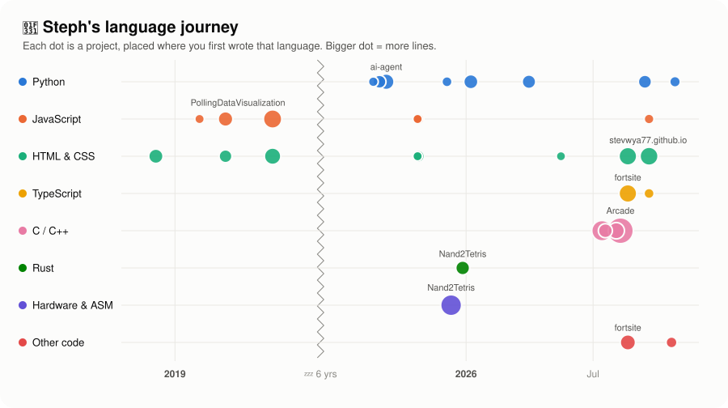
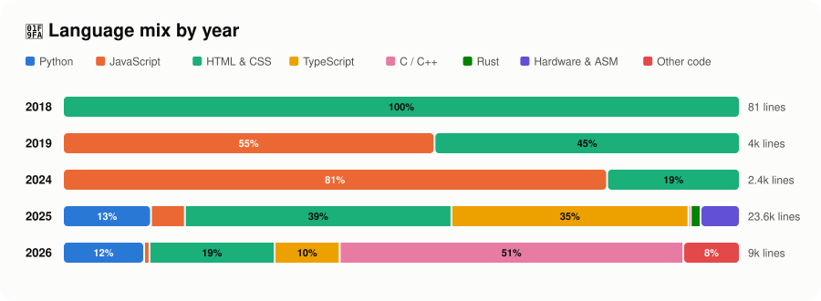

# 🌱 Steph's Language Garden

> **32 projects** · **8 language families** · **39,124 lines** written by me since 2018 · current favorite: ⚙️ **C / C++**

<picture>
  <source media="(prefers-color-scheme: dark)" srcset="assets/journey-dark.svg">
  
</picture>

## 🔓 Languages unlocked

| | Language | First project | Unlocked | Projects | Lines |
|---|---|---|---|---:|---:|
| 🎨 | **HTML & CSS** | `trueheart-mockup` | Dec 2018 | 14 | 13,356 |
| 🟨 | **JavaScript** | `JavaScript2019` | Feb 2019 | 10 | 5,430 |
| 🐍 | **Python** | `🔒 Private project 2` | Feb 2025 | 10 | 4,158 |
| 🔷 | **TypeScript** | `🔒 Private project 3` | Apr 2025 | 3 | 9,154 |
| ⚙️ | **C / C++** | `🔒 Private project 3` | Jun 2025 | 7 | 4,646 |
| 🔌 | **Hardware & ASM** | `Nand2Tetris` | Dec 2025 | 1 | 1,310 |
| 🦀 | **Rust** | `Nand2Tetris` | Dec 2025 | 1 | 343 |
| 🧩 | **Other code** | `🔒 Private project 8` | Feb 2026 | 3 | 727 |

## 🧺 How the mix changed

<picture>
  <source media="(prefers-color-scheme: dark)" srcset="assets/mix-dark.svg">
  
</picture>

## 🗂️ Every project

Show all projects, newest first

| Project | Started | Main language | Also used | My commits | Lines |
|---|---|---|---|---:|---:|
| `webbrowser` | Oct 2026 | 🐍 Python | — | 2 | 109 |
| `stevwya77.github.io` | Sep 2026 | 🎨 HTML & CSS | 🔷 TypeScript, 🟨 JavaScript | 15 | 985 |
| `ML_refresher` | Sep 2026 | 🐍 Python | — | 5 | 289 |
| `fortsite` | Aug 2026 | 🔷 TypeScript | 🎨 HTML & CSS, 🧩 Other code | 12 | 2,052 |
| `Arcade` | Aug 2026 | ⚙️ C / C++ | 🧩 Other code | 12 | 2,445 |
| `bounce` | Aug 2026 | ⚙️ C / C++ | — | 4 | 599 |
| `tictactoe` | Jul 2026 | ⚙️ C / C++ | — | 3 | 351 |
| `🔒 Private project 9` | Jul 2026 | ⚙️ C / C++ | — | 1 | 74 |
| `lazyfoo` | Jul 2026 | ⚙️ C / C++ | — | 1 | 1,222 |
| `signupform` | Apr 2026 | 🎨 HTML & CSS | — | 4 | 53 |
| `neetcode-submissions-dp8kzxsx` | Mar 2026 | 🐍 Python | — | 5 | 315 |
| `🔒 Private project 8` | Feb 2026 | 🧩 Other code | — | 4 | 112 |
| `static_site_generator` | Jan 2026 | 🐍 Python | — | 8 | 364 |
| `Nand2Tetris` | Dec 2025 | 🔌 Hardware & ASM | 🦀 Rust | 13 | 1,653 |
| `adventofcode2025` | Dec 2025 | 🐍 Python | — | 5 | 89 |
| `calculator` | Oct 2025 | 🎨 HTML & CSS | 🟨 JavaScript | 4 | 315 |
| `etchasketch` | Oct 2025 | 🎨 HTML & CSS | 🟨 JavaScript | 1 | 122 |
| `🔒 Private project 6` | Oct 2025 | 🎨 HTML & CSS | — | 2 | 436 |
| `🔒 Private project 7` | Oct 2025 | 🟨 JavaScript | 🎨 HTML & CSS | 2 | 149 |
| `🔒 Private project 5` | Oct 2025 | 🎨 HTML & CSS | — | 1 | 206 |
| `🔒 Private project 4` | Oct 2025 | ⚙️ C / C++ | — | 2 | 26 |
| `ai-agent` | Sep 2025 | 🐍 Python | — | 6 | 532 |
| `asteroids-clone` | Aug 2025 | 🐍 Python | — | 10 | 275 |
| `bookbot` | Aug 2025 | 🐍 Python | — | 4 | 69 |
| `🔒 Private project 3` | Apr 2025 | 🎨 HTML & CSS | 🔷 TypeScript, 🐍 Python, 🟨 JavaScript, ⚙️ C / C++ | 63 | 19,154 |
| `🔒 Private project 2` | Feb 2025 | 🐍 Python | — | 16 | 586 |
| `🔒 Private project 1` | Dec 2024 | 🟨 JavaScript | 🎨 HTML & CSS | 6 | 2,413 |
| `PollingDataVisualization` | May 2019 | 🟨 JavaScript | 🎨 HTML & CSS | 3 | 1,502 |
| `PollingDataVisualization` | May 2019 | 🟨 JavaScript | 🎨 HTML & CSS | 3 | 1,502 |
| `retro-board` | Mar 2019 | 🟨 JavaScript | 🎨 HTML & CSS | 4 | 673 |
| `JavaScript2019` | Feb 2019 | 🟨 JavaScript | — | 3 | 60 |
| `trueheart-mockup` | Dec 2018 | 🎨 HTML & CSS | — | 9 | 392 |

🪴 Grown by <code>langprog.py</code> on Oct 29, 2026. Counts lines I added in my own commits (merges, data files, lockfiles and vendored code skipped). Notebooks count code cells only.
