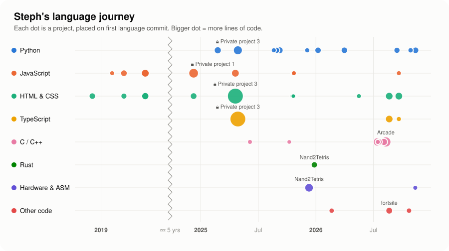

# Hi, I'm Stephanie

Breadboard tinkerer on weekends, writing code that actually works the rest of the week.

I like building things that show what's happening underneath. Lately that's been a debugger that makes memory visible, a computer built from NAND gates, and a C++ game engine with a CRT filter.

Right now I'm learning assembly and Verilog, and I'm always up for collaborating on open source, especially tracking down tricky issues and adding tests.

<h3 align="left">Connect with me:</h3>

<picture>
  <source media="(prefers-color-scheme: dark)" srcset="assets/journey-dark.svg">
  
</picture>
